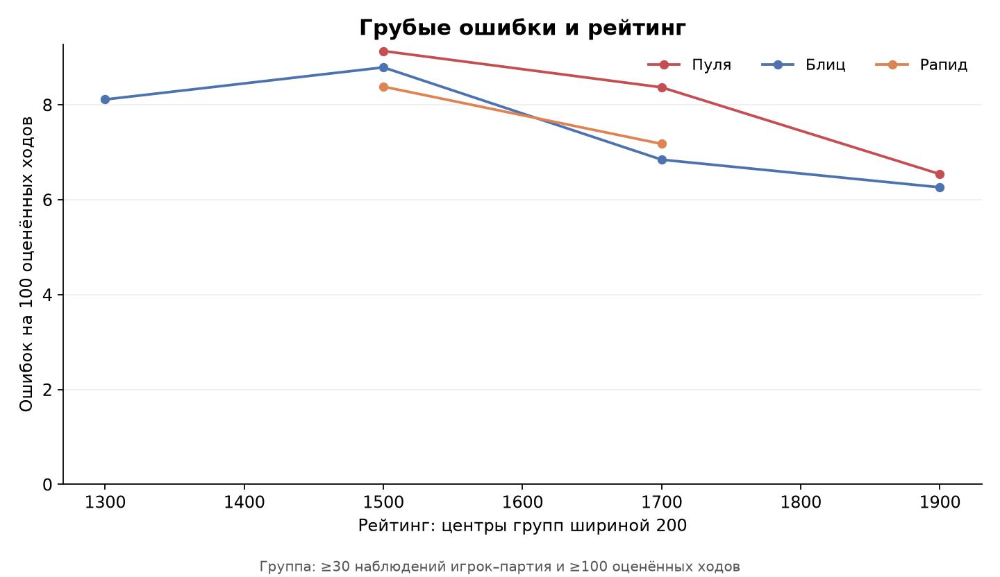
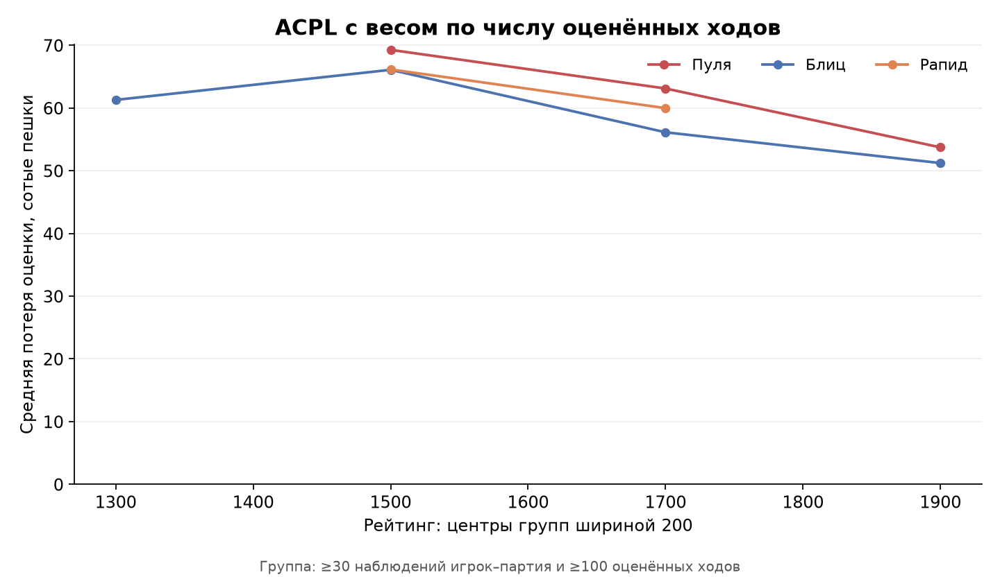
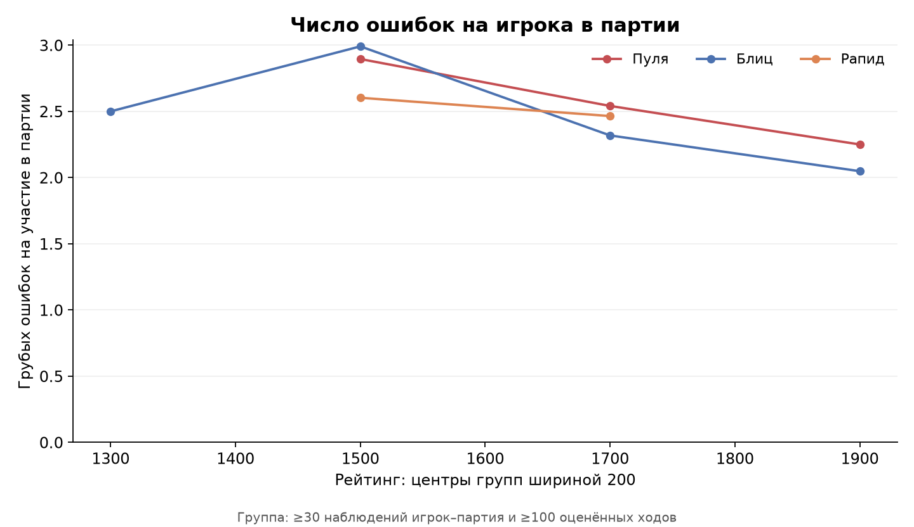
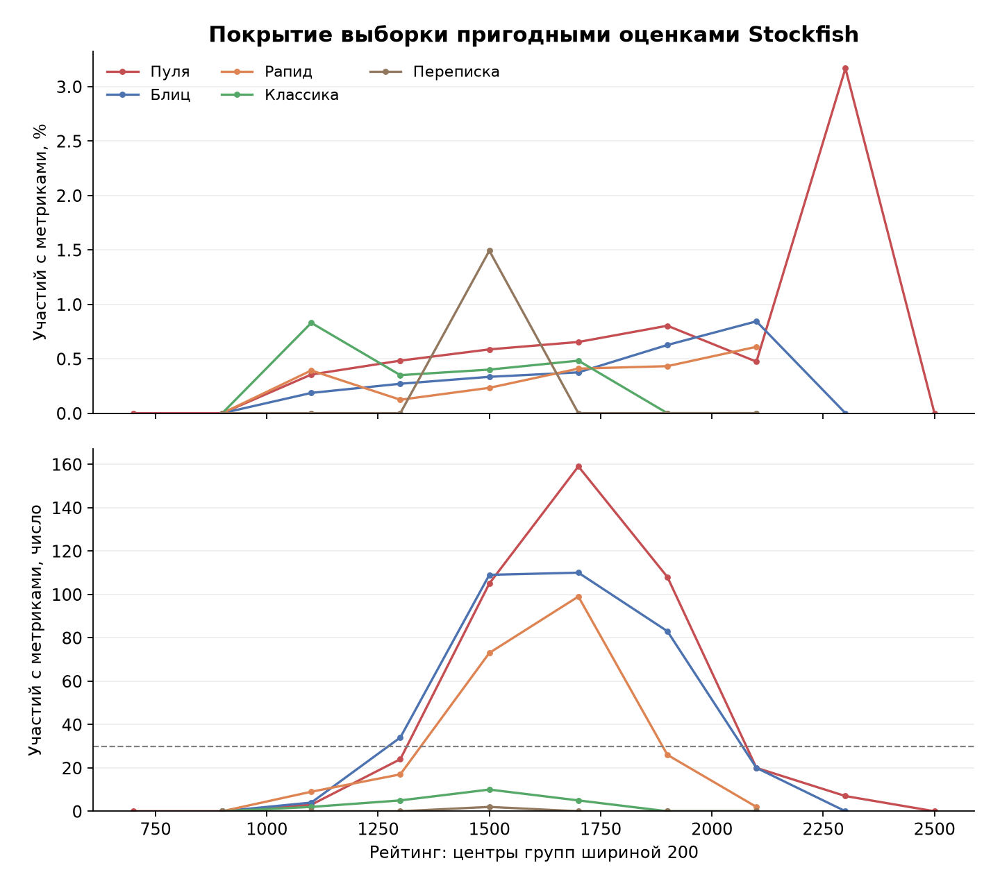

# Задача 4 — ошибки, ACPL и рейтинг

## Данные и метод

Входные файлы: `games_2013-01.csv`.
Классификация контроля: base_sec + 40 × inc_sec; единые современные границы Lichess.
Выбранные контроли: Ультрапуля, Пуля, Блиц, Рапид, Классика, Переписка. Анализируются завершённые партии. Повторы game_id удалены между всеми файлами; сохранена первая завершённая запись.

Месяц определяется по `utc_date`, а не имени дампа: в месячном файле могут встречаться партии с датой соседнего месяца.

## Качество данных

| Показатель | Число |
| --- | --- |
| Прочитано строк | 121332 |
| Исключено строк без game_id | 0 |
| Исключено незавершённых/неизвестных результатов | 0 |
| Исключено повторов game_id (среди завершённых) | 0 |
| Уникальных завершённых партий | 121332 |
| Расхождений метки speed и расчёта по времени | 39080 |
| Партий без корректного контроля времени | 0 |
| Исключено вне выбранных контролей | 0 |
| Партий в анализе | 121332 |
| Партий в анализе с неизвестной датой | 0 |
| Партий с отсутствующей/некорректной длиной | 0 |
| Партий с отсутствующим/некорректным рейтингом белых | 78 |
| Партий с отсутствующим/некорректным рейтингом чёрных | 140 |
| Партий с has_eval = 1 | 518 |
| Наблюдений с has_eval = 1, но непригодными метриками | 0 |
| Наблюдений с метриками, но без корректного рейтинга | 0 |
| Наблюдений игрок–партия с пригодными метриками и рейтингом | 1036 |

## Определения

- Единица наблюдения — игрок в партии: белые и чёрные учитываются отдельно со своим рейтингом.
- Грубая ошибка — потеря ≥200 сотых пешки по принятому парсером определению. Используются готовые `*_blunders`; новые оценки движком не рассчитываются.
- Основная частота = `100 × sum(blunders) / sum(evaluated)`. Нельзя делить на все ходы партии или заменять отсутствующие оценки нулём.
- ACPL по ходам = `sum(acpl × evaluated) / sum(evaluated)`. Это взвешенное среднее; исходные ACPL округлены парсером до 0.1, поэтому результат приближённый.
- Дополнительно сохранены среднее число ошибок на участие в партии, средний ACPL по участиям и доля участий хотя бы с одной грубой ошибкой.
- Рейтинговые группы: [нижняя граница, нижняя + 200). Графики основных метрик показывают группы с ≥30 участиями и ≥100 оценёнными ходами. CSV содержит и меньшие группы.

## Сводка по рейтингам, все выбранные контроли

Объединённая таблица описывает состав выборки. Для сравнения рейтингов используйте также разрез по контролям и месяцам.

| Рейтинг от | Рейтинг до, не включая | Участий | Оценённых ходов | Грубых ошибок | Ошибок на 100 ходов | ACPL по ходам |
| --- | --- | --- | --- | --- | --- | --- |
| 1000 | 1200 | 18 | 600 | 107 | 17.833 | 126.318 |
| 1200 | 1400 | 80 | 2510 | 268 | 10.677 | 76.765 |
| 1400 | 1600 | 299 | 9716 | 889 | 9.15 | 68.707 |
| 1600 | 1800 | 373 | 12047 | 908 | 7.537 | 59.984 |
| 1800 | 2000 | 217 | 7202 | 456 | 6.332 | 52.123 |
| 2000 | 2200 | 42 | 1499 | 74 | 4.937 | 43.939 |
| 2200 | 2400 | 7 | 211 | 5 | 2.37 | 32.102 |

## Выводы по этой выборке

- Пригодных участий: 1 036 из 242 446 с известным рейтингом (0.43%).
- На 33 785 оценённых ходов приходится 2 707 грубых ошибок: 8.01 на 100 ходов; ACPL по ходам — 62.36.
- Ультрапуля: меньше двух групп достигают порогов; для описания связи рейтинга и ошибок данных недостаточно.
- Пуля: в нижней доступной группе [1400, 1600) — 9.13 ошибки на 100 ходов; в верхней [1800, 2000) — 6.54. Это сравнение крайних пригодных групп, а не доказательство монотонной зависимости.
- Блиц: в нижней доступной группе [1200, 1400) — 8.11 ошибки на 100 ходов; в верхней [1800, 2000) — 6.26. Это сравнение крайних пригодных групп, а не доказательство монотонной зависимости.
- Рапид: в нижней доступной группе [1400, 1600) — 8.38 ошибки на 100 ходов; в верхней [1600, 1800) — 7.17. Это сравнение крайних пригодных групп, а не доказательство монотонной зависимости.
- Классика: меньше двух групп достигают порогов; для описания связи рейтинга и ошибок данных недостаточно.
- Переписка: меньше двух групп достигают порогов; для описания связи рейтинга и ошибок данных недостаточно.

## Ограничения

- Проанализированные Stockfish партии — отобранная часть базы. График покрытия показывает различия отбора по рейтингу; результаты нельзя автоматически переносить на все партии.
- Оценки обрезаны парсером до ±1000 cp; мат заменён на ±1000. Первый ход белых и ходы без двух соседних оценок не учитываются. Это учебная метрика проекта, она не обязана совпадать с метками ошибок на сайте Lichess.
- В выборку метрик входит участие с `has_eval=1`, корректным рейтингом, конечным ACPL от 0 до 2000, целыми `evaluated>0` и `0≤blunders≤evaluated`. Количество оценённых ходов не может превышать доступное по `n_plies`.
- Частота на оценённый ход — основная метрика. Число ошибок на партию зависит от её длины и полноты оценок; считать его самостоятельной мерой силы игрока нельзя.
- Рейтинги относятся к разным пулам и периодам; единая классификация времени не пересчитывает рейтинги. Контроли и месяцы сохранены раздельно для проверки смешения выборок.
- Идентификаторов игроков в CSV нет: участия повторных игроков не независимы. Пороги на графиках — фильтр малых групп, не проверка статистической значимости. Причинные выводы и доверительные интервалы по независимым ходам не строятся.

## Графики

## Таблицы

- `blunders_by_rating.csv`: объединённые рейтинговые группы.
- `blunders_by_speed_rating.csv`: основные сравнения внутри контролей.
- `blunders_by_month_speed_rating.csv`: контроль периода и состава выборки.
- `blunders_by_color_rating.csv`: белые и чёрные раздельно внутри контроля.
- `analysis_coverage.csv`, `coverage_by_month.csv`: доля пригодных участий среди всех с известным рейтингом.
- `run_metadata.json`: входы, параметры, версии библиотек и качество данных.
