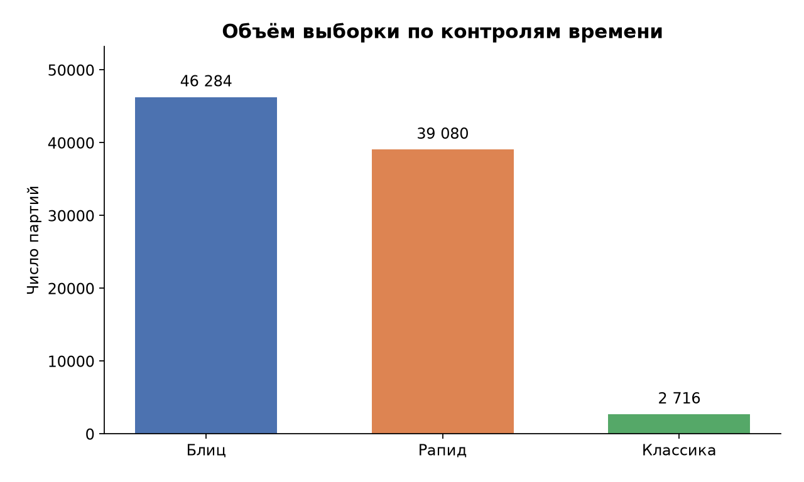
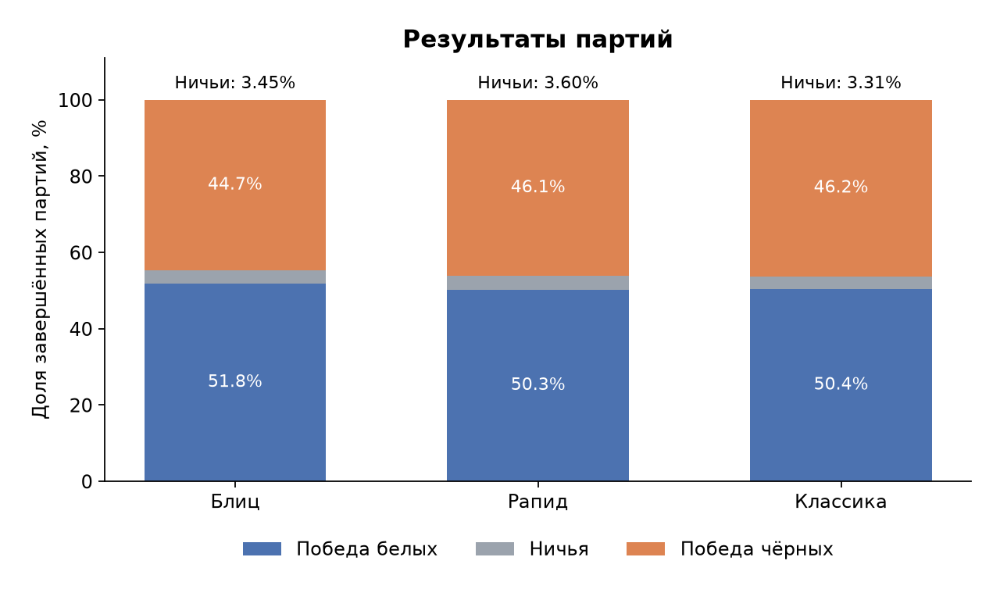
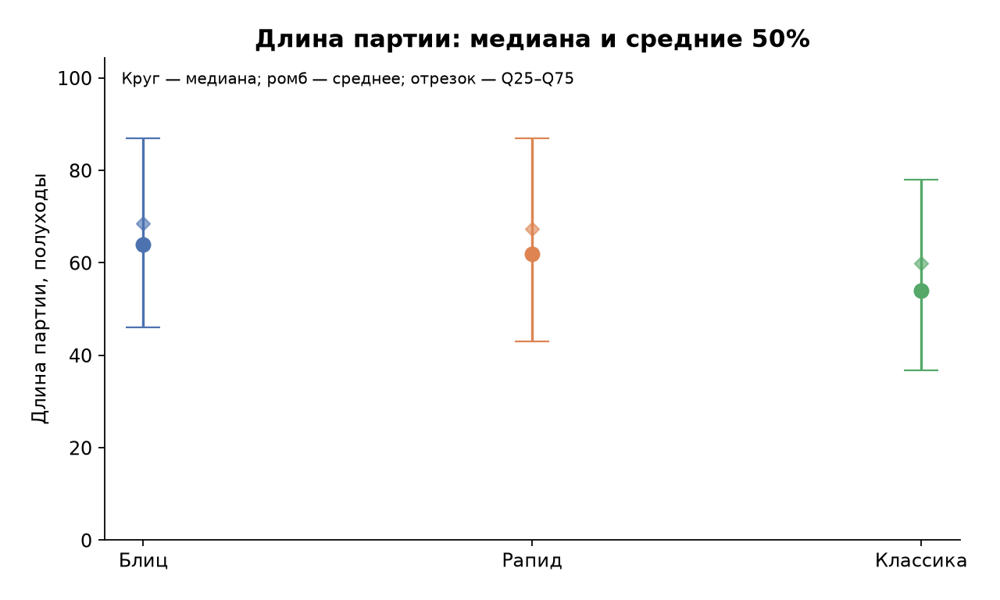
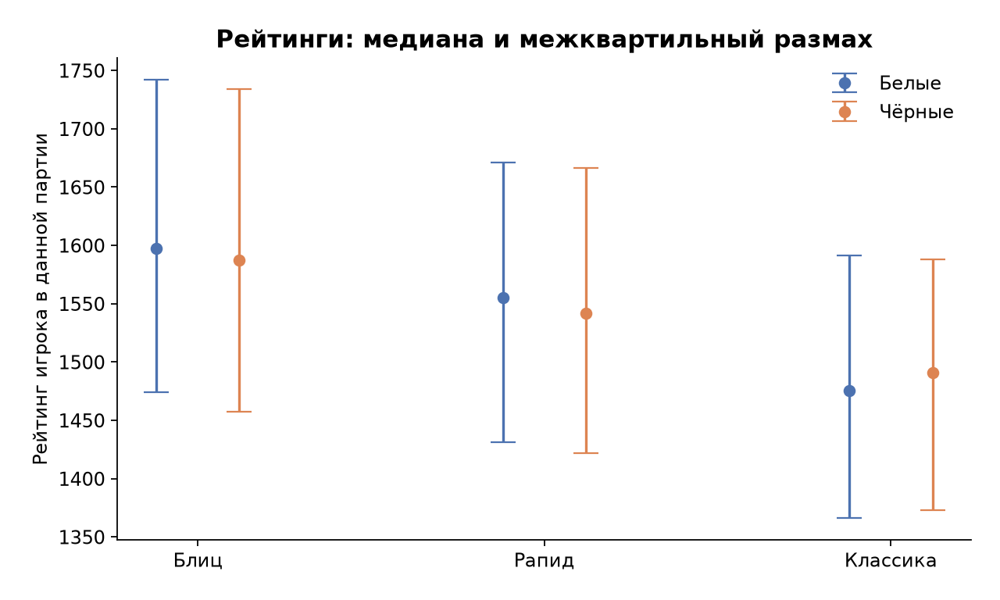
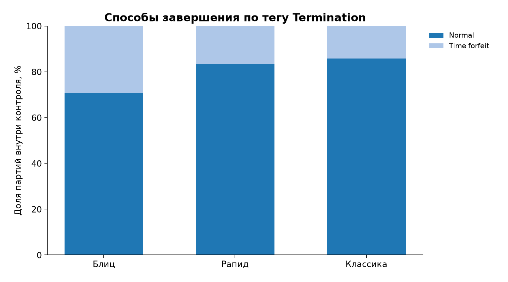

# Задача 3 — контроли времени

## Данные и метод

Входные файлы: `games_2013-01.csv`.
Классификация контроля: base_sec + 40 × inc_sec; единые современные границы Lichess.
Выбранные контроли: Блиц, Рапид, Классика. Анализируются завершённые партии. Повторы game_id удалены между всеми файлами; сохранена первая завершённая запись.

Месяц определяется по `utc_date`, а не имени дампа: в месячном файле могут встречаться партии с датой соседнего месяца.

## Качество данных

| Показатель | Число |
| --- | --- |
| Прочитано строк | 121332 |
| Исключено строк без game_id | 0 |
| Исключено незавершённых/неизвестных результатов | 0 |
| Исключено повторов game_id (среди завершённых) | 0 |
| Уникальных завершённых партий | 121332 |
| Расхождений метки speed и расчёта по времени | 39080 |
| Партий без корректного контроля времени | 0 |
| Исключено вне выбранных контролей | 33252 |
| Партий в анализе | 88080 |
| Партий в анализе с неизвестной датой | 0 |
| Партий с отсутствующей/некорректной длиной | 0 |
| Партий с отсутствующим/некорректным рейтингом белых | 49 |
| Партий с отсутствующим/некорректным рейтингом чёрных | 79 |
| Партий с has_eval = 1 | 304 |

## Сравнение

| Контроль | Партий | Ничьих, % | Среднее, полуходы | Медиана, полуходы | Рейтинг белых | Рейтинг чёрных |
| --- | --- | --- | --- | --- | --- | --- |
| Блиц | 46284 | 3.448 | 68.477 | 64 | 1606.052 | 1593.666 |
| Рапид | 39080 | 3.603 | 67.244 | 62 | 1550.163 | 1542.796 |
| Классика | 2716 | 3.314 | 59.858 | 54 | 1478.033 | 1480.972 |

## Выводы по этой выборке

- Больше всего партий: Блиц — 46 284.
- Наибольшая наблюдаемая доля ничьих: Рапид — 3.60%.
- Блиц: медиана 64 полуходов, средние 50% партий — от 46 до 87 полуходов.
- Рапид: медиана 62 полуходов, средние 50% партий — от 43 до 87 полуходов.
- Классика: медиана 54 полуходов, средние 50% партий — от 36.75 до 78 полуходов.

## Ограничения и определения

- Длина — `n_plies`, число отдельных ходов сторон. Это не время в минутах. В текущем CSV нет показаний часов, только флаг `has_clock`.
- Доли результатов считаются от всех завершённых партий соответствующего контроля. Результативность — доля побед (1 − доля ничьих); `white_score` учитывает ничью как 0.5.
- `Normal` в Termination не позволяет разделить мат, сдачу и другие нормальные окончания. Пустой тег показан как `Unknown`; более подробные причины не выдумываются.
- Классы времени вычислены по единым границам, если не задан `--speed-source event`. Это полезно для старых PGN, но не превращает исторические рейтинги в рейтинги современного пула.
- Рейтинги описывают участия игроков в партиях, а не уникальных людей. Средние используют только известные значения; их знаменатели сохранены в CSV.
- Сравнение описательное: рейтинг, год, состав игроков и отбор месяцев могут влиять на результат. Статистическая значимость и причинный эффект контроля времени здесь не утверждаются.

Источник границ: [Lichess FAQ](https://lichess.org/faq#time-controls).

## Графики

## Таблицы

- `speed_summary.csv`: сводка и знаменатели метрик.
- `speed_by_month.csv`: те же средние и доли по месяцам.
- `terminations.csv`: число и доля каждого окончания внутри контроля.
- `length_distribution.csv`, `rating_distribution.csv`: точные частотные распределения.
- `run_metadata.json`: входы, параметры, версии библиотек и качество данных.
